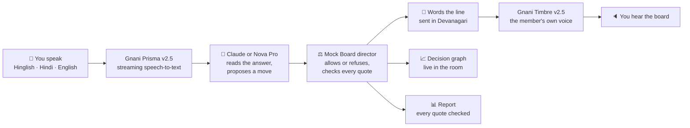
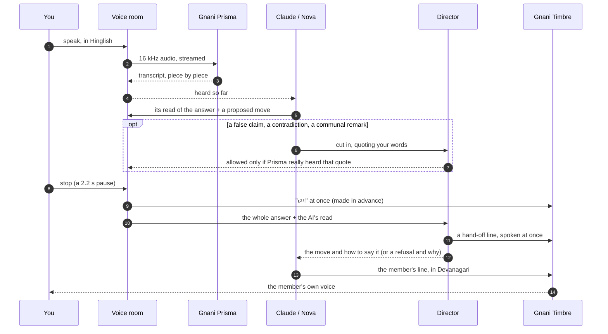
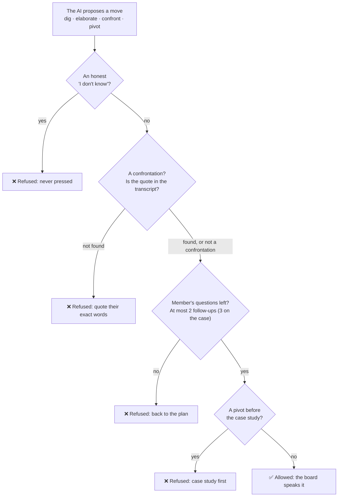
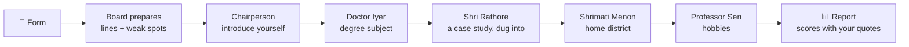

<div align="center">

# 🎙️ Mock Board

### A UPSC interview board with ears, a voice and a spine.

Five AI board members hear you in **Hinglish**, speak in their own voices, and push back like a real
board. They hold you to your own words, cut in on a false claim, and never press an honest *"I don't know"*.

[](https://www.gnani.ai/)
[](https://www.gnani.ai/)
[](docs/MCP_QUICKSTART.md)
[](docs/DEVELOPING.md#run-the-tests-and-the-linter)
[](pyproject.toml)

**[▶ Watch the demo](https://drive.google.com/file/d/1FqRW-nMtw_vbR4CB7Gb0z9akvbcY4x-J/view?usp=sharing)** ·
**[One-page pitch](PITCH.md)** ([PDF](PITCH.pdf)) ·
**[Try it in one command](#-try-it)** ·
**[How it works](#-how-it-works)**

</div>

---

## Why

The interview is the hardest stage of UPSC to practise. Good mock boards are costly and few, mostly
in big cities and mostly in English, while many candidates think and speak in Hinglish or Hindi.
Typing into a chatbot doesn't train the real skill: answering **out loud, under pressure, to a
panel that is listening**.

## What it does

| | |
|---|---|
| 🧾 **Prepares from your form** | A short, fictional form becomes each member's lines of questioning and the weak spot they expect to probe, drawn live as an animated graph. |
| 🪑 **Runs a real board's order** | Introduction → degree subject → a case study, dug into → home district → hobbies, across five fictional members, each in a different Gnani Timbre voice. |
| 👂 **Listens while you speak** | Gnani Prisma streams your words as you say them. The board can **cut in** on a false claim, **nudge** ("point par aaiye"), or **stop when you talk over it**, and it remembers what it hadn't said yet. |
| ⚖️ **Is blunt, and fair** | It names a thin or hedged answer plainly, confronts contradictions with your exact words, answers a communal remark with equal dignity, and never presses an honest "I don't know". |
| 📊 **Reports with evidence** | Scores on the qualities UPSC looks for, each backed by a quote from your answers, and each quote checked against the transcript. |
| 🧑‍🏫 **Also includes** | **Mitra**, a study partner on any topic (it answers your questions and corrects a wrong fact kindly), and a **debate** mode. |

Languages: Hinglish, Hindi and English; Tamil-English exists but has not been reviewed by a fluent
speaker yet.

## 🚀 Try it

You need a Mac or Linux machine, Python 3.12 or newer, Chrome, and your own
[Gnani API key](https://app.gnani.ai/voice). For the Claude-powered board you also need
[Claude Code](https://docs.claude.com/en/docs/claude-code), installed and signed in.

**1. One command: the local app, with Claude as the brain**

```bash
git clone https://github.com/yashg16422-design/mockboard && cd mockboard && bash scripts/quickstart.sh
```

Open **http://localhost:7870** in Chrome with headphones on, fill a fictional form (or type a study
topic) and press **Start with Claude**. No Gnani key? Add `--fake` to try it free, with typed answers.

**2. As an MCP connector in your own Claude** (run from the `mockboard` folder, after step 1)

```bash
claude mcp add mockboard -- "$PWD/.venv/bin/python" -m mockboard.mcp
```

Then just say *"start a UPSC mock interview"*. Claude Desktop setup and the in-chat voice room are
covered in [docs/MCP_QUICKSTART.md](docs/MCP_QUICKSTART.md).

**3. The web app on Amazon Nova Pro:** `make voice-install && make voice-upsc` (needs AWS Bedrock
access in `ap-southeast-2`; see [docs/DEVELOPING.md](docs/DEVELOPING.md)).

## 🧠 How it works

### The big picture



**Gnani does the ears and the voice, the model does the words, and Mock Board's code makes every
decision.** That split is the core idea: the model can be swapped (Claude, Nova, or any MCP client),
but fairness and structure come from code that can be read and tested.

### One answer, end to end



Because the AI's judgement travels *with* the answer, the board decides the moment you stop. Only
one model step is left (wording the line), and the fixed lines and the "हम्म" fill the gap.

### The referee: the model proposes, code decides



Requests (*repeat*, *skip*, *time to think*, *end the interview*) and the equal-dignity rule always
come first. Every outcome is shown live in the decision graph, so a refused move is visible, with
its reason.

### The sitting



Each member's mood follows your answers: patient after an honest "I don't know", sceptical after a
hedge, pressing when challenging, satisfied after a reasoned answer.

## 🔧 Technical walkthrough

**Speech, built for Indian voices**
([`mcp/voice_bridge.py`](src/mockboard/mcp/voice_bridge.py),
[`speech/`](src/mockboard/speech/))
- **Gnani Prisma v2.5:** audio is streamed in 1,024-byte frames while you speak. At the end of an
  answer the bridge waits for the transcript of your *last* words before handing it on, and the
  page low-pass filters the microphone before resampling to 16 kHz so consonants survive.
- **Gnani Timbre v2.5:** each member has a voice, and Hindi lines are sent in Devanagari. Speech
  is pipelined: the first sentence goes alone so the voice starts sooner, and the next piece is
  made while the current one plays.
- **Talking over the board:** a sustained voice stops it at once. The last 1.5 s before is kept,
  so your first words are heard, and the AI is told what was left unsaid.

**Two brains, one engine** ([ADR-009](docs/adr/ADR-009-modes-as-profiles.md))
- **MCP** ([`mcp/`](src/mockboard/mcp/)): a stdio JSON-RPC server with 14 tools. The voice room is
  also an MCP App view inside Claude. `wait_for_answer(interim, decide, read)` streams the answer
  in and decides at its end; `next_turn(proposal, cut_in)` and `nudge` let the model lead under
  the director's checks.
- **The Claude room** ([`claude_room/`](src/mockboard/claude_room/)): a local web app on the Claude
  Agent SDK. Claude gets *only* Mock Board's tools (no shell, files or web), runs on the person's
  own plan, and thinks at low effort, because every second is heard.
- **The Nova web app:** "fast mouth, slow brain" on Pipecat 1.5 (SmallWebRTC, Silero VAD, Smart
  Turn v3). LangGraph runs the slow brain ([`brain/graphs.py`](src/mockboard/brain/graphs.py)):
  - listener → strategist;
  - a fact-check fan-out with a numeric gate;
  - judge → citation check → one revision → report.

  Three Bedrock lanes with short hot-lane timeouts keep it alive under throttling, and a chaos test
  proves it.

**The director** ([`brain/director.py`](src/mockboard/brain/director.py),
[ADR-010](docs/adr/ADR-010-interview-director.md))
- **Rules decide, not the model:** every move has a rule id (`D-HANDOFF`, `D-DEEP`, `M-CONFRONT`,
  …), and code-computed answer signals (hedged, thin, no reason given) drive the candour.
- **Fixed lines are fixed:** request phrases are matched by fixed rules in four languages, and
  numeric fact challenges need a checked source card and are always phrased as questions
  ([ADR-003](docs/adr/ADR-003-ask-never-assert.md)).

**Quality**
- **3,684 automated tests:** they include board-behaviour invariant suites, golden transcripts
  checked by hash, a real local WebSocket playing the page, and scripted stand-ins for Claude.
- **Gated commits:** every commit runs the full suite on what is staged.
- **Versioned prompts:** each prompt is a file in [`prompts/`](src/mockboard/prompts/) with a
  changelog.
- **Decision records:** the reasoning behind each design is in [`docs/adr/`](docs/adr/) and the
  [orchestrator log](docs/ORCHESTRATOR_LOG.md).

## 📏 Measured, honestly

| What | Result |
|---|---|
| Automated tests | **3,684 passing** offline (`make test`) |
| End of answer → the board's reasoned reply | **12–16 s → about 5 s** median (Claude, scripted speech) |
| Reaction ("हम्म") and hand-off lines | at once, while the next line is being worded |
| Cut-in on a planted false claim ("Newton gave relativity") | caught in **7 of 7** real Claude runs |
| Live sittings | on Amazon Nova Pro and on Claude, with Gnani Prisma and Timbre |

**Not yet done:**
- a review of the Tamil lines by a fluent speaker;
- real fact cards, so real sessions run without fact checks and say so;
- measurements across many real voices.

All test data is synthetic, every board member is fictional, and their voices are generated by
Gnani Timbre. A report from this board is practice feedback, not a UPSC mark.

## 🧰 Built with

**Gnani Prisma v2.5** · **Gnani Timbre v2.5** · Amazon Nova Pro (Bedrock) · Claude (MCP, Agent SDK) ·
Pipecat · LangGraph · Silero VAD · Python

## 📚 More

- [docs/DEVELOPING.md](docs/DEVELOPING.md): setup, offline runs, tests, evaluation, probes, traces
  and the repository map
- [docs/WALKTHROUGH.md](docs/WALKTHROUGH.md): the learning guide to the whole system
- [docs/MCP_QUICKSTART.md](docs/MCP_QUICKSTART.md): Mock Board in Claude Desktop and Claude Code
- [docs/PROJECT_AND_DEMO_BRIEF.md](docs/PROJECT_AND_DEMO_BRIEF.md): positioning and validation gaps

<div align="center">

Built solo by **Yash Pratap Singh** for Gnani.ai's **Great Indian AI Internship Challenge 2026**.
<br/>#GnaniAI · #GreatIndianAIInternshipChallenge

</div>
